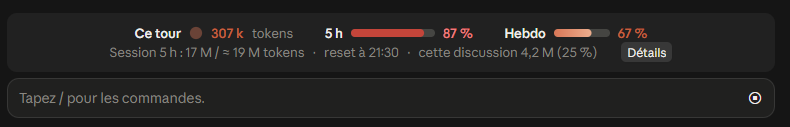
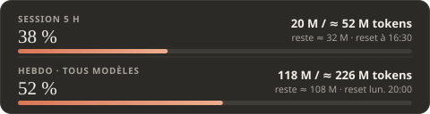
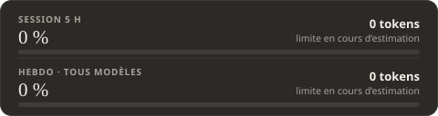
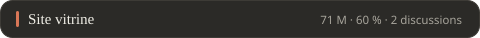
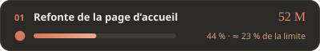
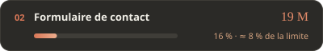
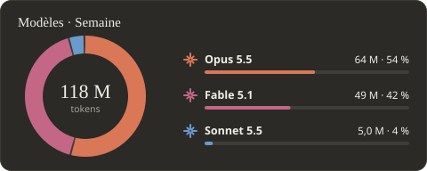
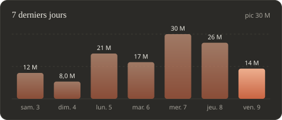
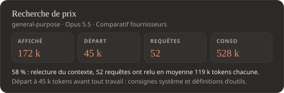

# Conso pour Claude

[English](README.md) · **Français**

Un mod pour l'onglet **Code** de l'application Claude (Windows, macOS et Linux) qui affiche ta consommation de tokens en direct.

**Gratuit et open source** (licence [MIT](LICENSE)) : tout le code est dans ce dépôt, tu peux le lire avant d'installer quoi que ce soit. Le mod ne fait que lire des fichiers de ton ordinateur et n'envoie rien sur Internet.

- **Une bande au-dessus de la zone de saisie** : le tour en cours, la session de 5 h et la semaine.
- **Un panneau de détail** (bouton Détails ou commande `/conso`) : conso par projet et par discussion, par agent, par modèle, et chronologie, sur la session de 5 h, la journée ou la semaine.
- **Six langues** : français, anglais, espagnol, allemand, portugais, italien. Le mod suit la langue de ton système ; une liste en haut à droite du panneau permet d'en choisir une autre.
- **`/conso-refresh`** (expérimental) : fait apparaître la bande dans les discussions ouvertes avant l'installation, en arrêtant leur moteur au repos pour que l'app le relance. Elle ne touche à rien tant qu'une de ces discussions travaille. Si une discussion ne se rouvre pas bien ensuite, ferme et relance Claude.

> Le mod repose sur une fonction en accès anticipé de l'application Claude (les plugins à « function hooks »). Il peut ne pas se charger sur toutes les installations ni toutes les versions de l'application.

## À quoi ça ressemble

La bande, toujours visible au-dessus de la zone de saisie :



Le panneau de détail (les chiffres ci-dessous sont des exemples) :

| Limites du forfait | Au premier lancement |
| --- | --- |
|  |  |

| Par discussion | Par modèle |
| --- | --- |
| <br><br> |  |

| Chronologie | Agents |
| --- | --- |
|  |  |

## Installer ou mettre à jour

Un installeur par système, le même pour installer et pour mettre à jour. Tous récupèrent la dernière version de ce dépôt ; tes chiffres et ton historique sont conservés. Les installeurs parlent français ou anglais, selon la langue de ton système.

> [!NOTE]
> **Un message de sécurité est normal avec les installeurs téléchargés.** Le `.exe` sous Windows (navigateur, puis Windows SmartScreen) et le `.zip` sous macOS (Gatekeeper) peuvent afficher un message du type « téléchargement suspect » ou « développeur non identifié ». Il apparaît pour tout petit programme non signé, la signature étant payante ; il ne veut pas dire que quelque chose a été détecté. Pas d'inquiétude : tout le code est open source, dans ce dépôt, et tu peux le lire avant de lancer quoi que ce soit. Pour éviter le message, utilise l'installation en une ligne.

### Windows

**En une ligne (conseillé)** : aucun programme à télécharger, donc aucun avertissement de Windows.

1. Ouvre le menu Démarrer, tape `PowerShell` et ouvre **Windows PowerShell**.
2. Colle cette ligne, puis appuie sur Entrée :

   ```powershell
   irm https://raw.githubusercontent.com/GetPiraa/claude-conso/main/installer-windows.ps1 | iex
   ```

3. Réponds `o` à la confirmation, puis ferme complètement Claude et relance-le.

La ligne télécharge [ce script](installer-windows.ps1), que tu peux lire avant de le lancer.

**Ou avec l'installeur à double-clic** :

1. Télécharge [`Conso-for-Claude.exe`](https://github.com/GetPiraa/claude-conso/raw/main/Conso-for-Claude.exe) et lance-le.
2. Ton navigateur puis Windows affichent un avertissement (« téléchargement suspect », « éditeur inconnu ») : c'est le cas de tout petit programme non signé, la signature étant payante. Dans Windows : « Informations complémentaires », puis « Exécuter quand même ».
3. Ferme complètement Claude et relance-le.

### macOS

**En une ligne (conseillé)** : rien à télécharger, donc aucun avertissement de macOS.

1. Ouvre l'application **Terminal** (Spotlight : `Cmd + Espace`, tape `Terminal`).
2. Colle cette ligne, puis appuie sur Entrée :

   ```bash
   curl -fsSL https://raw.githubusercontent.com/GetPiraa/claude-conso/main/installer-mac.sh | bash
   ```

3. Réponds `o` à la confirmation, puis ferme complètement Claude et relance-le.

La ligne télécharge [ce script](installer-mac.sh), que tu peux lire avant de le lancer.

**Ou avec l'installeur à double-clic** :

1. Télécharge [`Conso-for-Claude-mac.zip`](https://github.com/GetPiraa/claude-conso/raw/main/Conso-for-Claude-mac.zip) et ouvre-le.
2. Double-clique sur **Install Conso.command**. Si macOS refuse de l'ouvrir (développeur non identifié) : clic droit sur le fichier > **Ouvrir**, puis de nouveau **Ouvrir**.
3. Réponds `o` à la confirmation, puis ferme complètement Claude et relance-le.

### Linux

```bash
curl -fsSL https://raw.githubusercontent.com/GetPiraa/claude-conso/main/installer-mac.sh | bash
```

### Ce qu'il te faut

- l'application Claude, récente, avec l'onglet Code ;
- [Node.js](https://nodejs.org), dont le mod se sert pour additionner les tokens.

## Ce que l'installeur modifie

1. Il copie le mod dans `%USERPROFILE%\.claude\mods\conso` (sur Mac : `~/.claude/mods/conso`).
2. Il ajoute ce dossier à `CLAUDE_CODE_PLUGIN_DIRS` dans `%USERPROFILE%\.claude\settings.json`, en gardant l'ancien fichier en `settings.json.avant-conso.bak`.

Le mod lit les transcripts de tes discussions dans `%USERPROFILE%\.claude\projects` et écrit un cache dans `%USERPROFILE%\.claude\conso-cache`. Il n'envoie rien sur Internet. Seul l'installeur se connecte, à GitHub, pour récupérer la dernière version.

## À savoir sur les chiffres

> [!NOTE]
> **Le calcul des limites en tokens est encore en chantier.** Anthropic publie des pourcentages, pas des nombres de tokens, et remonter de l'un à l'autre est plus compliqué qu'il n'y paraît. C'est pour ça que ces limites continuent de s'ajuster au fil de ta consommation. Les tokens mesurés et les pourcentages sont fiables ; la limite en tokens est la meilleure estimation du mod à ce jour.

- Les tokens sont **pondérés** : une sortie compte plus qu'une entrée, une relecture de cache presque rien. La pondération suit les prix de l'API ; ce n'est pas la formule officielle des limites, qu'Anthropic ne publie pas.
- Les **limites en tokens** sont estimées (tokens mesurés ÷ pourcentage officiel). Le mod les trouve tout seul après quelques requêtes et les affine les jours suivants. Ce que tu consommes ailleurs avec le même forfait (autre ordinateur, onglet Discussion, cloud) fait monter le pourcentage officiel sans rien ajouter aux tokens mesurés ici, ce qui fait paraître la limite plus petite qu'elle ne l'est : le mod garde donc la plus haute mesure solide des dix derniers jours. Prends le résultat comme un ordre de grandeur. Les pourcentages, eux, sont les officiels.
- Seul ce qui est consommé **dans l'onglet Code, sur ce PC** est compté. L'onglet Discussion et les discussions cloud ne le sont pas.

## Où ça fonctionne

| Type de discussion (onglet Code) | Bande et panneau |
| --- | --- |
| **Local**, sous Windows ou macOS | Oui |
| **Local**, sous Linux | Devrait fonctionner pareil, mais pas encore testé |
| **Cloud** et **fils d'un projet** (bêta) | Pas avec l'installeur : voir « Dans un projet » ci-dessous |
| **Contrôle à distance** | Seulement si le mod est installé sur la machine qui héberge la discussion |
| **WSL**, **SSH** | Non pris en charge pour l'instant : le moteur tourne sous Linux ou sur une autre machine |

L'onglet Discussion et Cowork n'acceptent pas les mods.

### Dans un projet (bêta)

Les fils d'un projet tournent par défaut dans le cloud, qui ne lit ni les réglages ni les mods de ton PC. Deux façons d'y avoir le mod :

1. **Faire tourner le fil sur ton PC** : dans le fil, menu **+** > **Travailler en local** (« Work locally »). Le fil utilise alors les réglages de ta machine.
2. **Ajouter le mod au projet** (expérimental) : dans les réglages du projet, section **Plugins**, ajoute le plugin `conso` depuis la marketplace `GetPiraa/claude-conso`. Il se charge dans les nouveaux fils cloud. Il n'y voit que la conso de ce fil : la bande affiche les pourcentages officiels et les tokens du fil, sans limite estimée.

Tous les abonnements sont pris en charge sans réglage : le mod ne contient aucune limite en dur, il les déduit des pourcentages officiels de ton compte.

## Désinstaller

Supprime le dossier `%USERPROFILE%\.claude\mods\conso`, retire son chemin de `CLAUDE_CODE_PLUGIN_DIRS` dans `settings.json`, et supprime `%USERPROFILE%\.claude\conso-cache` si tu ne veux pas garder l'historique.

## Contribuer

Le projet est ouvert, sous licence [MIT](LICENSE). Un bug, un correctif, une meilleure formule de calcul : voir [CONTRIBUTING.fr.md](CONTRIBUTING.fr.md).

## Pour les curieux

- `conso/` : le mod (`hooks/` pour l'affichage, `hooks/lang/` pour les langues, `bin/scan.mjs` pour le comptage, `tests/`).
- `installeur/` : la source de l'installeur et le script qui le compile.
- Depuis Claude Code en terminal : `/plugin install conso --marketplace GetPiraa/claude-conso`.
