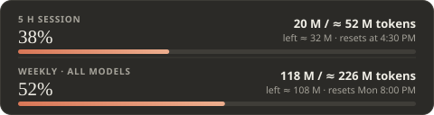
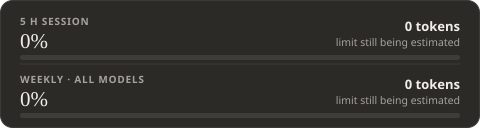
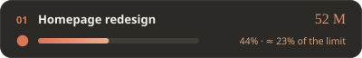
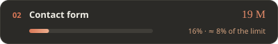
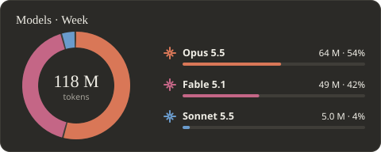
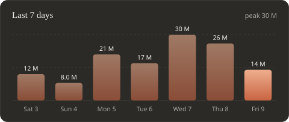
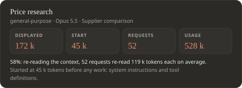

# Conso: live token usage for Claude

**English** · [Français](README.fr.md)

A mod for the **Code** tab of the Claude app (Windows, macOS and Linux) that shows your token usage live. "Conso" is short for *consommation*, the French word for consumption.

**Free and open source** ([MIT](LICENSE) license): all the code is in this repository, so you can read it before installing anything. The mod only reads files on your computer and sends nothing over the Internet.

- **A band above the prompt box**: the current turn, the 5-hour session and the week.
- **A detail panel** (Details button or `/conso` command): usage per project and per conversation, per agent, per model, and a timeline.
- **Six languages**: English, French, Spanish, German, Portuguese, Italian. The mod follows your system language; a list at the top right of the panel lets you pick another one.
- **`/conso-refresh`** (experimental): makes the band appear in conversations that were open before the install, by stopping their idle engine so the app restarts it. It touches nothing while one of those conversations is working. If a conversation does not reopen properly afterwards, close and restart Claude.

> The mod relies on an early-access feature of the Claude app (plugins with function hooks). It may not load on every setup or every version of the app yet.

## What it looks like

The band, always visible above the prompt box:


The detail panel (the figures below are examples):

| Plan limits | On first launch |
| --- | --- |
|  |  |

| Per conversation | Per model |
| --- | --- |
| <br><br> |  |

| Timeline | Agents |
| --- | --- |
|  |  |

## Install or update

One installer per system, the same one to install and to update. They all fetch the latest version from this repository; your figures and your history are kept. The installers speak English or French, depending on your system language.

### Windows

**In one line (recommended)**: no program to download, so no Windows warning.

1. Open the Start menu, type `PowerShell` and open **Windows PowerShell**.
2. Paste this line, then press Enter:

   ```powershell
   irm https://raw.githubusercontent.com/GetPiraa/claude-conso/main/installer-windows.ps1 | iex
   ```

3. Answer `y` to the confirmation, then quit Claude completely and start it again.

The line downloads [this script](installer-windows.ps1), which you can read before running it.

**Or with the double-click installer**:

1. Download [`Conso-for-Claude.exe`](https://github.com/GetPiraa/claude-conso/raw/main/Conso-for-Claude.exe) and run it.
2. Your browser and then Windows show a warning ("suspicious download", "unknown publisher"): this happens with any small unsigned program, since code signing is a paid service. In Windows: "More info", then "Run anyway".
3. Quit Claude completely and start it again.

### macOS

**In one line (recommended)**: nothing to download, so no macOS warning.

1. Open the **Terminal** app (Spotlight: `Cmd + Space`, type `Terminal`).
2. Paste this line, then press Enter:

   ```bash
   curl -fsSL https://raw.githubusercontent.com/GetPiraa/claude-conso/main/installer-mac.sh | bash
   ```

3. Answer `y` to the confirmation, then quit Claude completely and start it again.

The line downloads [this script](installer-mac.sh), which you can read before running it.

**Or with the double-click installer**:

1. Download [`Conso-for-Claude-mac.zip`](https://github.com/GetPiraa/claude-conso/raw/main/Conso-for-Claude-mac.zip) and open it.
2. Double-click **Install Conso.command**. If macOS refuses to open it (unidentified developer): right-click the file > **Open**, then **Open** again.
3. Answer `y` to the confirmation, then quit Claude completely and start it again.

### Linux

```bash
curl -fsSL https://raw.githubusercontent.com/GetPiraa/claude-conso/main/installer-mac.sh | bash
```

### What you need

- a recent Claude app, with the Code tab;
- [Node.js](https://nodejs.org), which the mod uses to add up the tokens.

## What the installer changes

1. It copies the mod into `%USERPROFILE%\.claude\mods\conso` (on a Mac: `~/.claude/mods/conso`).
2. It adds that folder to `CLAUDE_CODE_PLUGIN_DIRS` in `%USERPROFILE%\.claude\settings.json`, keeping the previous file as `settings.json.avant-conso.bak`.

The mod reads the transcripts of your conversations in `%USERPROFILE%\.claude\projects` and writes a cache in `%USERPROFILE%\.claude\conso-cache`. It sends nothing over the Internet. Only the installer connects, to GitHub, to fetch the latest version.

## About the figures

- Tokens are **weighted**: an output token counts more than an input token, a cache re-read almost nothing. The weighting follows the API prices; it is not the official formula behind the limits, which Anthropic does not publish.
- The **limits in tokens** are estimated (tokens measured ÷ official percentage). The mod works them out by itself after a few requests and keeps refining them over the following days.
- Only what is used **in the Code tab, on this computer** is counted. The Chat tab and cloud conversations are not.

## Where it works

| Kind of conversation (Code tab) | Band and panel |
| --- | --- |
| **Local**, on Windows or macOS | Yes |
| **Cloud** and **project threads** (beta) | Not with the installer: see "In a project" below |
| **Remote Control** | Only if the mod is installed on the machine hosting the conversation |
| **WSL**, **SSH** | Not supported for now: the engine runs on Linux or on another machine |

The Chat tab and Cowork do not accept mods.

### In a project (beta)

Project threads run in the cloud by default, which reads neither the settings nor the mods of your computer. Two ways to get the mod there:

1. **Run the thread on your computer**: in the thread, **+** menu > **Work locally**. The thread then uses your machine's settings.
2. **Add the mod to the project** (experimental): in the project settings, **Plugins** section, add the `conso` plugin from the `GetPiraa/claude-conso` marketplace. It loads in new cloud threads. There it only sees that thread's usage: the band shows the official percentages and the thread's tokens, without an estimated limit.

Every subscription plan is supported without any setting: the mod contains no hard-coded limit, it derives them from your account's official percentages.

## Uninstall

Delete the `%USERPROFILE%\.claude\mods\conso` folder, remove its path from `CLAUDE_CODE_PLUGIN_DIRS` in `settings.json`, and delete `%USERPROFILE%\.claude\conso-cache` if you do not want to keep the history.

## Contributing

The project is open, under the [MIT](LICENSE) license. A bug, a fix, a better formula: see [CONTRIBUTING.md](CONTRIBUTING.md).

## For the curious

- `conso/`: the mod (`hooks/` for the display, `hooks/lang/` for the languages, `bin/scan.mjs` for the counting, `tests/`).
- `installeur/`: the installer's source and the script that builds it.
- From Claude Code in a terminal: `/plugin install conso --marketplace GetPiraa/claude-conso`.
- The code comments are in French.
